<p align="center">
  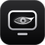
</p>

<h1 align="center">Vigil</h1>

<p align="center">
  <strong>Your PC, at a glance, on a small USB screen.</strong><br>
  Temperatures, load, memory, network, what's playing, the weather and the time.<br>
  A Windows app that runs in the tray. No account, no cloud, no telemetry.
</p>

<p align="center">
  <a href="https://github.com/JoaoMRB/Vigil/releases/latest/download/Vigil-Setup.exe"><strong>Download for Windows</strong></a>
  &nbsp;·&nbsp;
  <a href="#getting-started">Getting started</a>
  &nbsp;·&nbsp;
  <a href="CHANGELOG.md">What's new</a>
  &nbsp;·&nbsp;
  <a href="#troubleshooting">Troubleshooting</a>
</p>

<p align="center">
  <a href="LICENSE"></a>
  
  
</p>

<p align="center">
  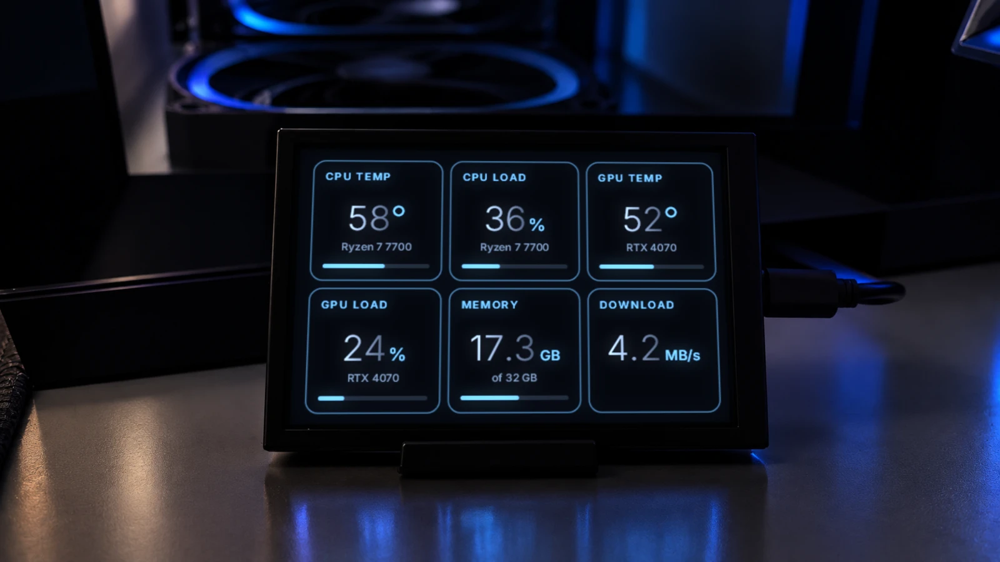
</p>

## Why Vigil

**At a glance.** CPU and GPU temperatures and load, clocks, power and fans, memory, the network, the volume, what's
playing, the weather and clocks around the world. One view, or several taking turns.

**It follows what you do.** Start a game and it shows the system view. Lock the PC and it dims to just the time.
Before the PC sleeps the screen turns off, and it comes back by itself when the PC wakes. At night it can turn
itself down.

**Yours to shape.** Seven designs for the system view, one of them with six cards you fill yourself. Five themes,
four clock fonts, your own colours. Stand the screen upright and every view has a layout made for it.

**Private and light.** No account and no telemetry. Vigil only goes online for the weather and to check for updates,
and you can turn off either one. It waits in the tray and stays out of the way.

## Gallery

### Views

| Clock | Weather and quote | World clocks |
| :---: | :---: | :---: |
| 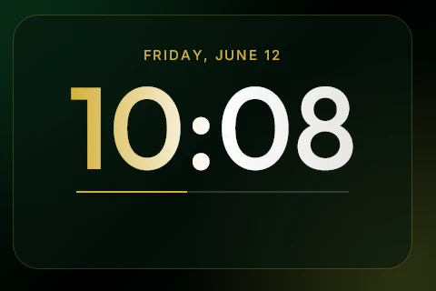 |  |  |
| **Now playing** | **System** | |
| 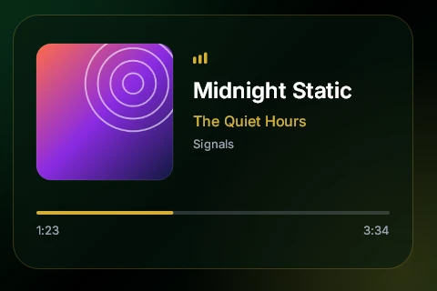 |  | |

### System designs

| Dashboard | Custom | Full panel | Gauges |
| :---: | :---: | :---: | :---: |
|  | 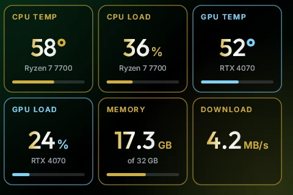 | 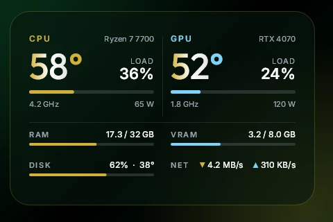 | 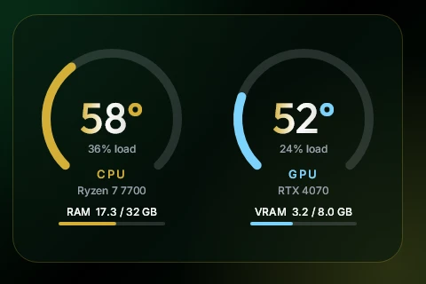 |
| **Bars** | **Graphs** | **Minimal** | |
| 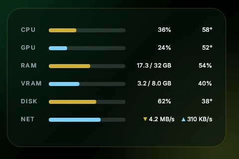 | 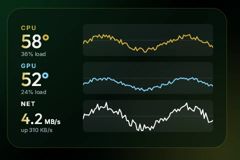 | 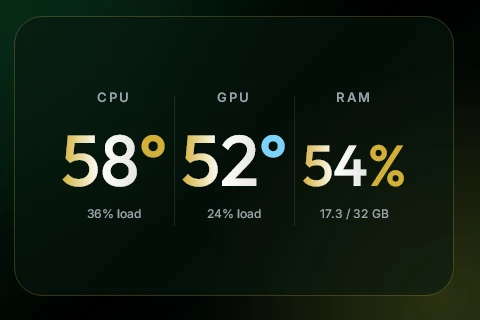 | |

### Standing upright

| Clock | Dashboard | Now playing |
| :---: | :---: | :---: |
| 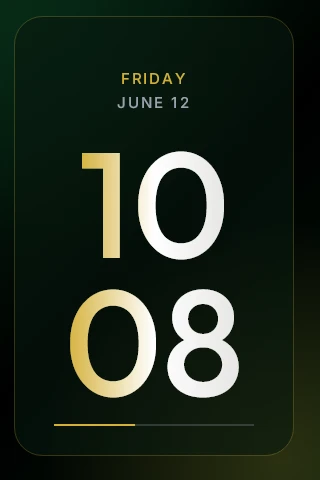 | 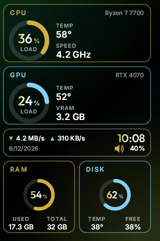 | 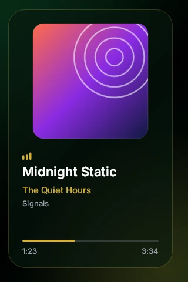 |

### The settings window

<p align="center">
  
</p>

The preview on the left is the exact picture sent to the screen, refreshed every second. Under it are the quick
controls: pick a view to keep it on the screen instead of the views taking turns, set the brightness, or turn the
screen off for now. Every change shows on the screen at once, and there is nothing to save.

## Getting started

**You need**

- A 3.5" **Turing Smart Screen** or **UsbMonitor** (see [supported screens](#supported-screens))
- Windows 10 version 2004 or later, or Windows 11, 64-bit

**Install**

1. Download **[Vigil-Setup.exe](https://github.com/JoaoMRB/Vigil/releases/latest/download/Vigil-Setup.exe)** and
   run it. Choose **Install for me only**, which doesn't need administrator rights, unless you plan to use the
   CPU temperature: then choose **Install for all users** (see [the sensors](#the-sensors)).
2. The installer isn't code-signed yet, so Windows may show *Windows protected your PC*. Choose
   **More info → Run anyway**.
3. Plug the screen in. Vigil finds it by itself, usually within a few seconds.

**Set it up**

1. Under **Views**, switch on what you want to see. With several views on, they take turns.
2. Under **System screen**, pick a design. With *Custom*, choose what each of the six cards shows.
3. Under **System**, switch on **Start with Windows**, so Vigil is there every time you sign in.
4. Optional: to see the CPU temperature, switch on **CPU temperature** and install [PawnIO](https://pawnio.eu/).
   See [the sensors](#the-sensors) below.

To update, run a newer installer over the old one, or take the update from the tray icon when Vigil offers it.
Your settings are kept.

## Features

### On the screen

- **Five views:** clock; system; weather with the quote of the day; up to three world clocks; and now playing.
  *Now playing* shows the cover, title, artist and progress of anything in Windows' media controls, such as Spotify,
  a browser or the Media Player. It takes its turn only while something plays.
- **Seven system designs:** Dashboard, Custom, Full panel, Gauges, Bars, Graphs and Minimal. Each one has its own
  colours, and you can change them, along with the temperature from which a reading counts as hot.
- **Custom:** six cards. Each card shows one of 18 readings, from the GPU fan to the upload speed.
- **Themes and fonts:** five themes (Dark Glass, the default, then Emerald Gold, Liquid Glass, Obsidian Platinum, Light Glass), four
  clock fonts, and a 12 or 24-hour clock.
- **Any way up:** landscape, upside down, or upright turned either way.
- **Languages:** the screen, the settings window and the tray menu follow Windows' language: English, Portuguese,
  Spanish, French, German or Italian.

### On its own

- **Locked:** while the PC is locked, the screen dims to just the time. It can also turn off, or keep going.
- **Asleep:** before the PC sleeps, the screen turns off. It comes back by itself when the PC wakes.
- **Games:** after a game or a video has filled the screen for 5 seconds, the display switches to the system view or
  the clock. It goes back to your views once you leave.
- **Night:** between two times you set, the backlight goes down.
- **Unplugged:** Vigil notices the moment the cable comes out, and draws again as soon as it goes back in.
- **Start with Windows:** Vigil waits in the tray. You can switch this in Vigil, or under *Startup apps* in Task
  Manager.
- **Updates:** once a day, Vigil checks GitHub for a newer version. When there is one, it offers it in the tray and
  at the top of the settings window, with what changed, and installs it only if you agree.

### The sensors

Windows only lets programs read some sensors when they run as administrator with a driver. To read those, switch
on **CPU temperature** under System and install the free [PawnIO](https://pawnio.eu/) driver. When a view needs
the CPU temperature and can't get it, the settings window shows a short guide: what is missing, a button for each
step, and a tick as each one is done. Until then, Vigil shows the CPU load where the temperature would be, and a
Custom card says what it is missing.

**Installed for all users** (under Program Files), Windows asks for administrator rights once, when you switch
CPU temperature on. After that Vigil starts with them at sign-in without asking. **Installed for you only**, Windows
asks each time Vigil starts. The reason is that any program you run can change the files of an app installed for you
only, and Vigil won't give administrator rights without a prompt to files that anything could have replaced. To
move to an install for all users, run the installer again and choose *Install for all users*: it removes the copy
installed for you only, and keeps your settings.

Without the driver, **Approximate CPU temperature** (under System, off by default) shows the motherboard's ACPI
thermal zone instead, marked with a `~`. That figure is often well below the CPU's own, and on many desktops it never
moves. When it stays put for five minutes while the CPU load swings, Vigil drops it and goes back to the load.

| Reading | Standard | CPU temperature mode + PawnIO |
| --- | :---: | :---: |
| CPU load | ✓ | ✓ |
| CPU temperature, clock and power | `~` approximate, if you switch it on | ✓ |
| CPU fan (from the motherboard) | | ✓ |
| GPU temperature, load, clock, power, fan and video memory | ✓ | ✓ |
| Memory, system drive, network, volume | ✓ | ✓ |
| Drive temperature | | ✓ |

## Supported screens

| Screen | Size | USB ID | Status |
| --- | --- | --- | --- |
| Turing Smart Screen 3.5" / UsbMonitor 3.5" ("rev. A") | 480 × 320 | `1A86:5722` | ✓ Supported |
| Turing Smart Screen 3.5" "rev. B" (XuanFang) | 480 × 320 | | Not yet |
| Turing Smart Screen 5" and 8.8" ("rev. C") | 800 × 480, 1920 × 480 | | Not yet |

The others need a screen to test with. If you have one and want to help, open an issue. Vigil is an independent
project, and isn't affiliated with the makers of these screens.

## Privacy

| What leaves your PC | When | To | Turn it off |
| --- | --- | --- | --- |
| Your city's position, rounded to about 1 km | Every 30 minutes, while the weather view is on | [Open-Meteo](https://open-meteo.com/) | Switch the weather view off |
| The app's name and version | Once a day | GitHub | *Check for updates*, under System |

That is all. There are no analytics, no telemetry and no account. Your settings stay in
`%AppData%\Vigil\settings.json`. What's playing is read on the PC, and it is never sent or logged.

Vigil also keeps a small log of what it did and the errors it met, in `%LocalAppData%\Vigil\logs`. The log stays on
your PC and stays under about 0.5 MB. It holds no city and no readings, and your user name is taken out of any path
in it.

## Troubleshooting

<details>
<summary><strong>The status says "Display not found"</strong></summary>

Check that the cable is in, and try a USB port on the PC itself rather than a hub. In Device Manager, the screen
should show under *Ports (COM & LPT)*, and it should appear and disappear as you plug and unplug it. If it never
appears, try another cable: some USB-C cables only carry power.
</details>

<details>
<summary><strong>The status says "Display in use by another program"</strong></summary>

Only one program at a time can talk to the screen. Close the screen maker's app, or any other monitoring app that
drives these screens, including one in the tray. Vigil connects by itself a few seconds later.
</details>

<details>
<summary><strong>The CPU shows its load, or "Admin mode only", instead of the temperature</strong></summary>

Switch on **CPU temperature** under System, and install [PawnIO](https://pawnio.eu/). Windows asks for
administrator rights, then Vigil restarts. It asks only once if Vigil is installed for all users, and each time
Vigil starts otherwise. The guide under *System screen* in the settings window walks you through
it. See [the sensors](#the-sensors).

A temperature with a `~` in front is the approximate one, from the motherboard. It isn't the CPU's own.
</details>

<details>
<summary><strong>Standing upright, the picture is sideways</strong></summary>

Under Appearance → *How the screen stands*, pick the other *Upright* choice. Which one is right depends on which
way you turned the screen.
</details>

<details>
<summary><strong>Now playing never shows up</strong></summary>

The view takes its turn only while something plays, and only for apps that show in Windows' media controls (the
box that appears next to the volume when you press a media key). Some players don't report to them.
</details>

<details>
<summary><strong>Windows says "Windows protected your PC" when I run the installer</strong></summary>

The installer isn't code-signed yet, so SmartScreen doesn't know it. Choose **More info → Run anyway**. The
installer's SHA-256 is listed on each release, so you can check the file you downloaded.
</details>

<details>
<summary><strong>Something else</strong></summary>

Under System, choose **Diagnostics → Copy**, and paste the result into a [new issue](https://github.com/JoaoMRB/Vigil/issues/new).
It holds the versions, the screen's state, the settings and the end of the log. It never holds your city, your
user name, your hardware's names or any readings.
</details>

## Roadmap

- The other screen models, once there is hardware to test them with.
- Several screens at once.

## Building from source

You need the .NET 9 SDK, and Inno Setup 6 for the installer.

```powershell
dotnet run --project Vigil        # run the app
.\build-installer.ps1             # build the installer into dist\
```

[docs/DEVELOPMENT.md](docs/DEVELOPMENT.md) covers the rest: the project's layout, the tools for checking a change
without a screen (a simulator among them), the README's pictures and how a version is released.

## Credits

Built with C# on .NET 9, [SkiaSharp](https://github.com/mono/SkiaSharp),
[LibreHardwareMonitorLib](https://github.com/LibreHardwareMonitor/LibreHardwareMonitor),
[NAudio](https://github.com/naudio/NAudio) and WebView2. Weather by [Open-Meteo](https://open-meteo.com/).

Vigil started as the Windows app of [AuraTime](https://github.com/JoaoMRB/AuraTime), a focus clock for the browser,
and goes on here on its own. If you used the AuraTime app, Vigil picks up your settings the first time it runs.

## License

[MIT](LICENSE). The fonts are under the SIL Open Font License; see [Vigil/Ui/fonts/README.md](Vigil/Ui/fonts/README.md).
