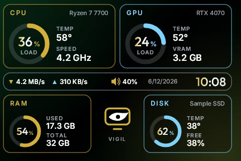
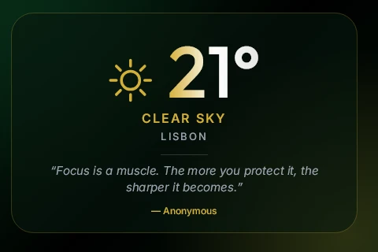
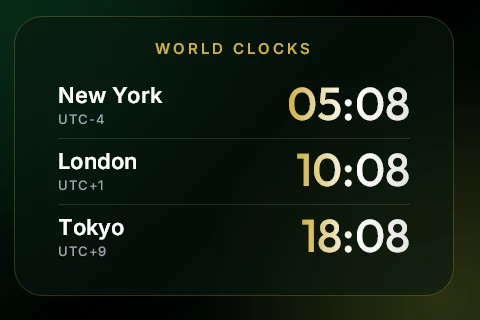
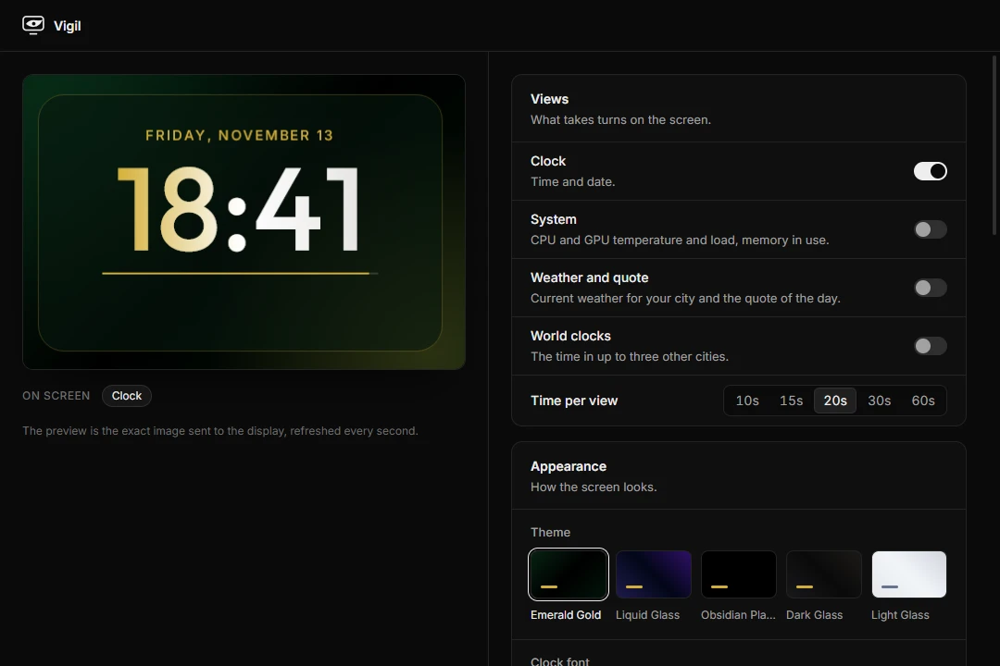

# Vigil

Your PC on a small USB screen: clock, CPU and GPU temperatures, memory, network, weather and world clocks.
Runs in the background on Windows. You don't need a browser or an account.

[](LICENSE)


<p align="center">
  
</p>

> Vigil started as the Windows app of [AuraTime](https://github.com/JoaoMRB/AuraTime), a focus clock for the
> browser. It now goes on here on its own. If you used the AuraTime app, Vigil picks up your settings the
> first time it runs.

## Supported screens

Vigil works with the 3.5" USB screens sold as **Turing Smart Screen** or **UsbMonitor** ("rev. A", USB `1A86:5722`,
480×320). Vigil is an independent project and is not affiliated with the makers of these screens.

## Download

**[Vigil-Setup.exe](https://github.com/JoaoMRB/Vigil/releases/latest/download/Vigil-Setup.exe)** ·
Windows 10 and 11, 64-bit · no administrator rights needed to install

To update, run the new installer over the old one. Your settings are kept.

## What it shows

| Clock | System | Weather | World clocks |
| :---: | :---: | :---: | :---: |
|  |  |  |  |

- **Views:** clock; system; weather with the quote of the day; and world clocks. The screen can show one
  view, or take turns between several.
- **System:** CPU and GPU temperature and load, memory, disk, network speed and volume. There are six designs
  (Dashboard, Full panel, Gauges, Bars, Graphs and Minimal), and you can change each design's colours.
- **CPU temperature:** Windows only shows this to programs that run as administrator and use a driver. To see
  it, turn on *CPU temperature* in the System settings and install the free [PawnIO](https://pawnio.eu/)
  driver. Without these, Vigil shows the CPU load instead.
- **Locked or asleep:** while the PC is locked the screen dims to just the time (or turns off, or keeps going, as you
  choose in the System settings). Before the PC sleeps it turns off, and it comes back by itself when the PC wakes.
- **Games:** while a game or video fills the PC's screen, the display can switch to the system view (or the clock),
  and go back to your views when you leave it.
- **Dim at night:** the backlight goes down between two times you set, such as 22:00 to 07:00.
- **Start with Windows:** Vigil waits in the notification area and draws on the screen as soon as the screen
  is plugged in. You can switch this on and off in Vigil, or under *Startup apps* in Task Manager.

<p align="center">
  
</p>

## Privacy

The only thing Vigil gets from the internet is the weather, from [Open-Meteo](https://open-meteo.com/), for the
city you pick. Before it is sent, your position is rounded to about 1 km. Vigil has no analytics and no
telemetry. Your settings stay in `%AppData%\Vigil\settings.json`.

Vigil keeps a small log of what it did and the errors it met, in `%LocalAppData%\Vigil\logs`, so a problem can
still be looked at later. It never leaves your PC, holds no city or readings, and your user name is replaced in
any path it writes down. It stays under about 0.5 MB. *Diagnostics → Copy*, under System in the settings, puts
the versions, the display's state, the settings and the end of this log on the clipboard, to paste into a bug report.

## Building

You need the .NET 9 SDK. The installer also needs Inno Setup 6 (`winget install JRSoftware.InnoSetup`).

```powershell
dotnet run --project Vigil          # run the app
.\build-installer.ps1               # writes dist\Vigil-Setup-<version>.exe and dist\Vigil-Setup.exe
```

To publish a version, attach `Vigil-Setup.exe` to a GitHub release that is **not** marked as a pre-release. The
download link points at the latest release, and GitHub skips pre-releases when it picks that one.

Tools for checking your work, with no screen attached:

```powershell
Vigil.exe --png out.png --view system --design dashboard --sample   # draw one screen to a file
Vigil.exe --sensors sensors.txt                                     # list every sensor found on this PC
Vigil.exe --simulate                                                # a pretend display in a window
Vigil.exe --simulate-test report.txt                                # check the link logic, PASS or FAIL per case
```

`--simulate` drives a pretend display with buttons to pull the cable, stall the link, refuse connections, lock the
PC and put it to sleep, so all of that can be tried without the hardware. `--simulate-test` runs those cases on its
own in about 30 seconds and exits with 0 when every one passes. Neither touches the real display, the start-up
entry or the settings file; both log to `%LocalAppData%\Vigil\logs\simulate`, or next to the report.

## Project structure

```
Vigil/
  Display/     the USB screen's serial protocol and connection
  Render/      the drawing (SkiaSharp): views, system designs and themes
  Ui/          the settings window, a page shown in WebView2
  i18n/        the texts on the screen, in en, pt, es, fr, de and it
  Sensors.cs   PC sensors (LibreHardwareMonitor)
  Settings.cs  the settings file
installer/     Inno Setup script
site/          the website: static HTML and CSS, deployed on Vercel (see site/README.md)
docs/brand/    the icon and the mark, as SVG
```

Built with C# on .NET 9, [SkiaSharp](https://github.com/mono/SkiaSharp),
[LibreHardwareMonitorLib](https://github.com/LibreHardwareMonitor/LibreHardwareMonitor),
[NAudio](https://github.com/naudio/NAudio) and WebView2.

## License

[MIT](LICENSE). The fonts are under the SIL Open Font License, see [Vigil/Ui/fonts/README.md](Vigil/Ui/fonts/README.md).
